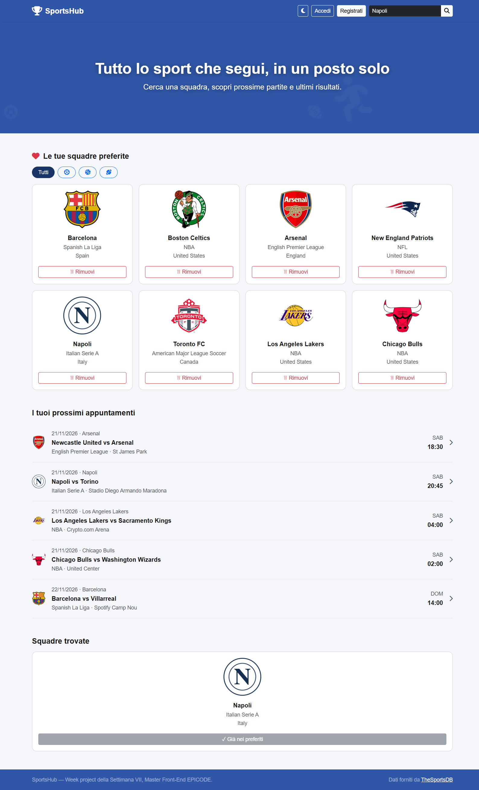
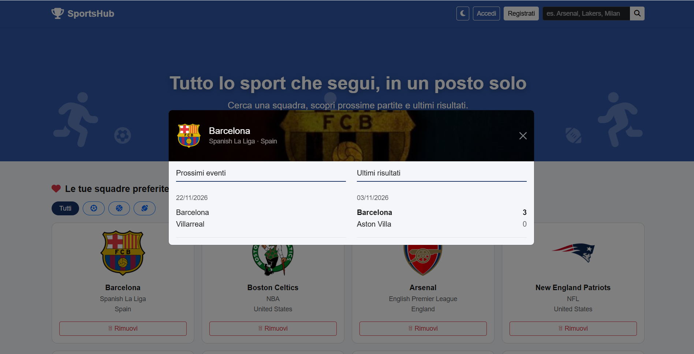
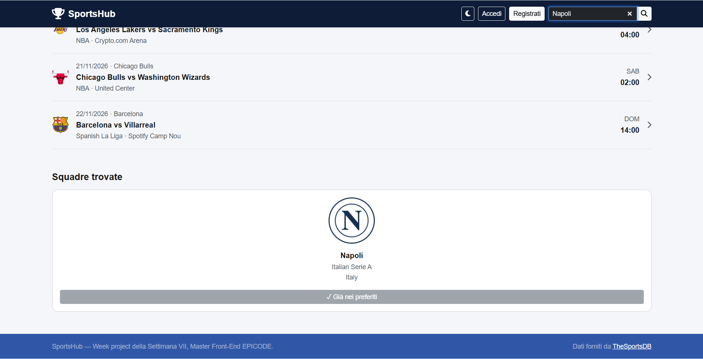

# SportsHub

Ricerca squadre sportive e consulta prossime partite e ultimi risultati,
con dati in tempo reale da TheSportsDB.

Week project della Settimana VII — Master Front-End EPICODE.

[Tutte le versioni rilasciate](https://github.com/emanuel95esposito-ops/Progetto-Settimana-7/releases)

## Anteprima

La pagina intera: apertura, squadre preferite con filtro per sport, prossimi
impegni e risultato della ricerca.

La scheda di un singolo evento, che si apre dalle liste delle partite.

Scorrendo oltre l'apertura la barra si scurisce, perché non ha più la hero
a farle da sfondo.

## Funzionalità

- Ricerca di una squadra per nome, mentre si digita, con annullamento della richiesta superata
- Card con stemma, campionato e paese, apribili anche da tastiera
- Scheda squadra: prossime partite e ultimi risultati, chiesti in parallelo
- Scheda del singolo evento: competizione, stagione, giornata, stadio, orario e highlights
- Squadre preferite salvate nel browser e legate all'utente che ha fatto accesso
- Filtro dei preferiti per sport
- I cinque impegni più vicini fra tutte le squadre salvate, in ordine di data
- Accesso e registrazione su pagine dedicate
- Tema chiaro e scuro: la scelta resta salvata, il primo avvio segue le impostazioni del sistema
- Apertura con le sagome dei tre sport che entrano dai lati, e barra che cambia tinta una volta superata
- Scheda squadra con l'immagine della squadra dietro l'intestazione, presa dall'API
- Segnaposto animati durante il caricamento e avvisi dedicati in caso di errore

## Tecnologie

HTML5, CSS3 con nesting nativo, Bootstrap 5.3, Font Awesome 6,
JavaScript ES6+ (classi, moduli, async/await).
Tutto da CDN: per la modalità predefinita non serve installare niente.

## API

[TheSportsDB](https://www.thesportsdb.com) — API REST pubblica, chiave di test gratuita.

| Endpoint | Scopo |
|---|---|
| `/searchteams.php?t=` | ricerca squadre per nome |
| `/eventsnext.php?id=` | prossime partite |
| `/eventslast.php?id=` | ultimi risultati |

La chiave di test gratuita è `123`, condivisa fra tutti quelli che la usano.
Comporta tre limiti, tutti gestiti dall'interfaccia:

- la ricerca restituisce **una sola squadra** per volta, quella che corrisponde meglio,
  quindi conviene scrivere il nome quasi per intero;
- molte squadre non espongono partite future;
- il servizio accetta **poche richieste al minuto** e oltre quella soglia le rifiuta.

Contro il terzo limite l'app si difende su tre fronti: una cache per squadra nel
`localStorage` valida dieci minuti, una pausa di trenta secondi dopo un rifiuto
invece di insistere, e messaggi che distinguono il servizio che non risponde
dalla connessione assente. Entrambe le durate sono costanti dichiarate in `assets/js/api.js`.

## Autenticazione

L'app usa due backend intercambiabili dietro la stessa interfaccia, selezionabili
dalla costante `MODALITA` in `auth/auth.js`:

**`"demo"` (predefinita)** — [DummyJSON](https://dummyjson.com).
Login reale con JWT salvato in localStorage, header `Authorization: Bearer`,
disconnessione automatica alla risposta 401. Funziona online senza installare nulla.
La registrazione non è disponibile: DummyJSON non espone un endpoint per creare utenti,
e il form lo dichiara invece di simularla.
Credenziali di prova: `emilys` / `emilyspass`, precompilabili dalla pagina di accesso.

**`"locale"`** — [json-server-auth](https://github.com/jeremyben/json-server-auth).
Registrazione e accesso completi su un backend finto in locale. Richiede:

    npm install
    npm run server:init    # solo la prima volta: crea db.json da db.example.json
    npm run server

e `MODALITA = "locale"`. Il server resta in ascolto su `http://localhost:3001`.
Il file `db.json` contiene gli account creati durante le prove e resta fuori dal
repository: in versione vuota è `db.example.json`.

L'accesso è facoltativo: ricerca, schede e preferiti funzionano anche senza.
Serve a legare i preferiti a un utente, così account diversi vedono elenchi
diversi, e chi non entra continua a usare un elenco anonimo.

## Come avviarlo

Serve un server locale: i moduli ES non funzionano aprendo il file con doppio clic.

1. Clona il repository
2. Apri la cartella in VS Code
3. Avvia Live Server su `index.html`

I comandi `npm` servono soltanto per provare la modalità `"locale"`.

## Struttura

    index.html
    auth/                 l'accesso sta tutto qui, pagine e script insieme
      login.html
      login.js
      register.html
      register.js
      auth.js             i due backend dietro un'interfaccia sola
    assets/
      css/style.css       variabili Bootstrap, due temi, poche regole proprie
      img/                le tre immagini del README
      js/
        classi.js         Squadra ed Evento
        api.js            chiamate a TheSportsDB, cache, pausa dopo un rifiuto
        ui.js             elementi della pagina, messaggi, spinner, barra utente
        render.js         card, liste di eventi e schede
        main.js           stato, ascoltatori, avvio
        tema.js           chiaro/scuro: scelta, memoria, bottone
    db.example.json       database vuoto per la modalità locale
    package.json          solo per la modalità locale

## Stato

- [x] Setup del progetto
- [x] Versione Base — ricerca squadre e dettaglio con Promise.all
- [x] Versione Intermedia — preferiti, debounce, layout responsive
- [x] Versione Avanzata — filtro per sport, modal evento, moduli ES
- [x] Extra — autenticazione a due backend
- [x] Extra — tema chiaro/scuro

## Versioni

| Tag | Contenuto |
|---|---|
| `v0.1.0` | ricerca squadre funzionante |
| `v0.2.0` | dettaglio squadra |
| `v1.0.0` | Versione Base completa |
| `v1.1.0` | Versione Intermedia: preferiti, debounce, layout responsive |
| `v1.2.0` | Versione Avanzata: modal evento, moduli ES, interfaccia rivista |
| `v1.3.0` | Extra: accesso con due backend intercambiabili e tema chiaro/scuro |
